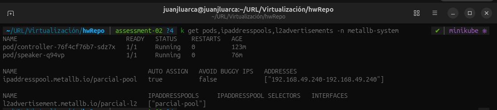
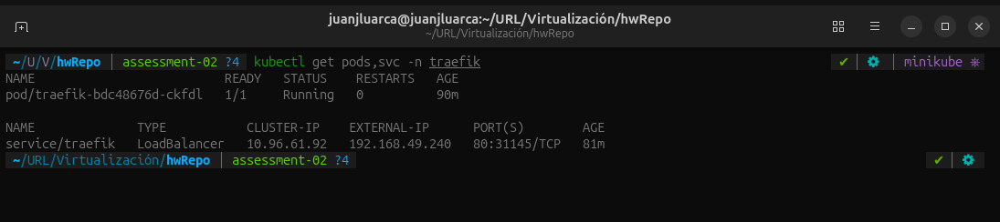
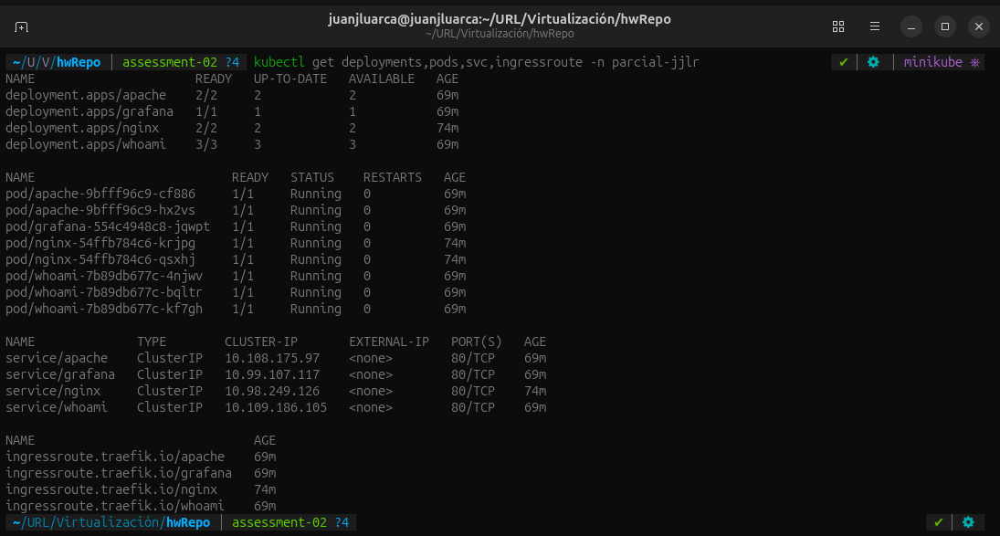
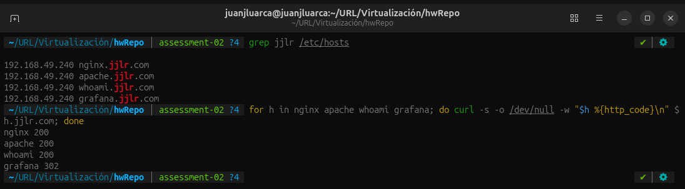
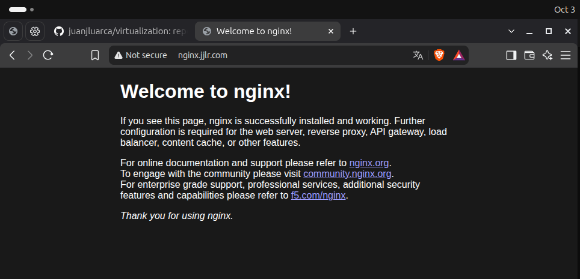
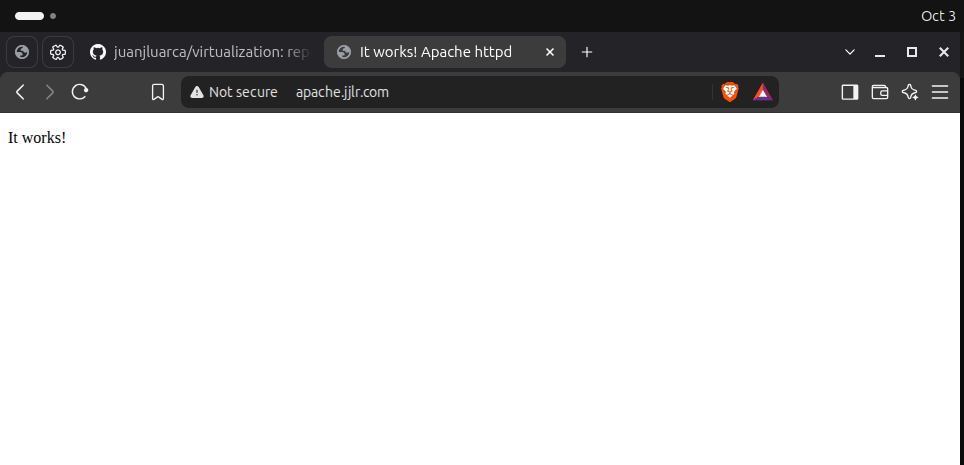
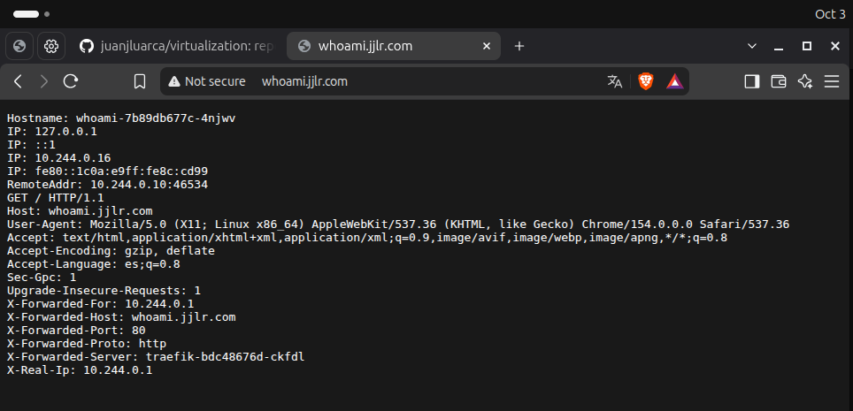
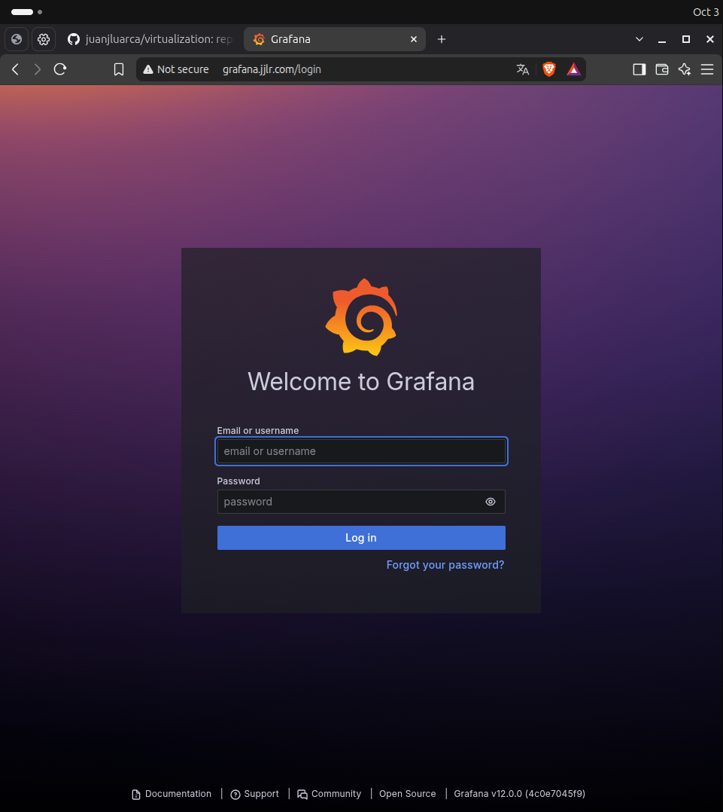

# Assessment 02

Clúster de Minikube que expone cuatro aplicaciones web por una única IP. MetalLB entrega la IP, Traefik la recibe en un Service de tipo LoadBalancer y enruta cada petición según el nombre de dominio.

### 1. Instalación de MetalLB

MetalLB v0.16.1 se instala con su manifiesto oficial en el namespace `metallb-system`.

```bash
curl -sLo metallb/00-metallb-native.yaml https://raw.githubusercontent.com/metallb/metallb/v0.16.1/config/manifests/metallb-native.yaml
kubectl apply -f metallb/00-metallb-native.yaml
kubectl apply -f metallb/01-pool.yaml
```

`metallb/01-pool.yaml` define un `IPAddressPool` con una sola IP (`192.168.49.240`, en la subred del nodo de Minikube) y un `L2Advertisement` que la anuncia en la red. Al manifiesto oficial se le agregó el argumento `--ignore-exclude-lb` en el speaker, porque el único nodo de Minikube es de control y MetalLB no anuncia IP desde esos nodos por defecto.



### 2. Instalación de Traefik

Traefik v3.7 se instala en el namespace `traefik`.

```bash
curl -sLo traefik/00-crds.yaml https://raw.githubusercontent.com/traefik/traefik/v3.7/docs/content/reference/dynamic-configuration/kubernetes-crd-definition-v1.yml
kubectl apply -f traefik/
```

- `00-crds.yaml`: definiciones de recursos de Traefik.
- `01-namespace.yaml`: namespace `traefik`.
- `02-rbac.yaml`: permisos para leer Services e IngressRoutes de todo el clúster.
- `03-deployment.yaml`: Deployment de Traefik con el punto de entrada `web` en el puerto 80.
- `04-service.yaml`: Service de tipo `LoadBalancer`, que recibe la IP de MetalLB.



### 3. Deployments y Servicios

Las cuatro aplicaciones están en el namespace `parcial-jjlr`. Cada archivo de `apps/` contiene un Deployment, un Service de tipo ClusterIP y un IngressRoute que asocia el dominio con el Service, de modo que Traefik es la única entrada desde fuera del clúster.

- nginx: `nginx:stable-alpine`, 2 réplicas, `nginx.jjlr.com`
- apache: `httpd:2.4-alpine`, 2 réplicas, `apache.jjlr.com`
- whoami: `traefik/whoami:v1.12`, 3 réplicas, `whoami.jjlr.com`
- grafana: `grafana/grafana:12.0.0`, 1 réplica, `grafana.jjlr.com`

```bash
kubectl apply -f apps/
```



### 4. DNS local

Se agregaron cuatro registros a `/etc/hosts` apuntando a la IP del LoadBalancer de Traefik.



### 5. Acceso desde el navegador





