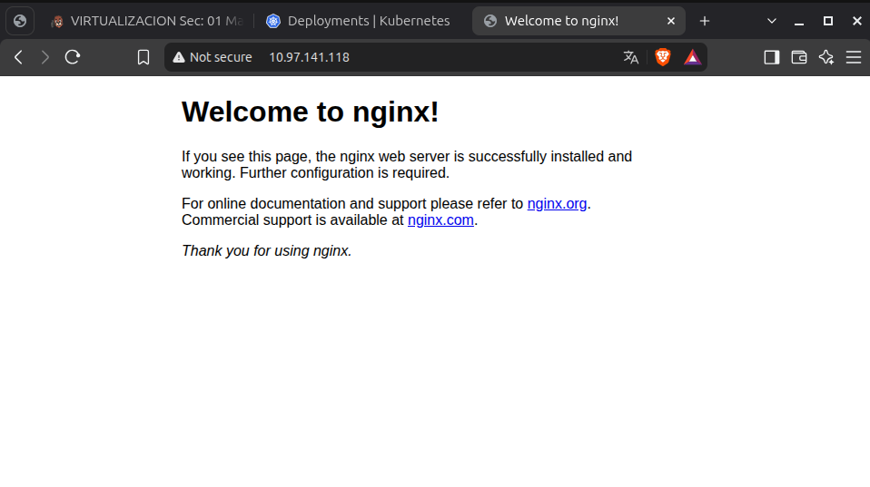
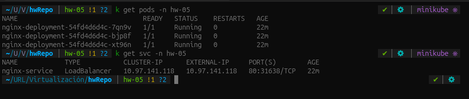

# Homework 05

Los manifiestos están en la carpeta k8s: namespace.yaml crea el namespace hw-05, nginx-deployment.yaml despliega Nginx con 3 réplicas y nginx-service.yaml expone el puerto 80 mediante un Service de tipo LoadBalancer.

Para reproducirlo, con minikube iniciado, se ejecutan estos comandos desde la raíz del repositorio. El tercer comando se deja corriendo en otra terminal.

```
kubectl apply -f k8s/namespace.yaml
kubectl apply -f k8s/
minikube tunnel
```

Captura del navegador haciendo la llamada al servicio en http://10.97.141.118:



Salida de kubectl get svc en el namespace hw-05:


