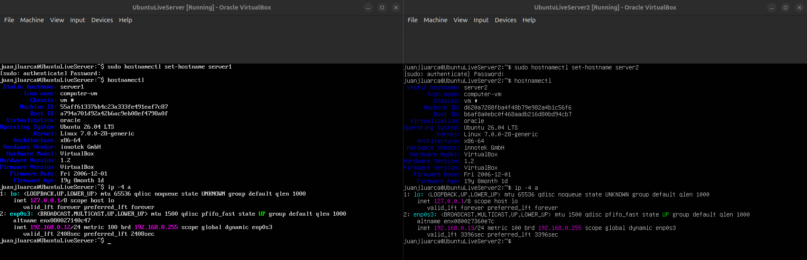
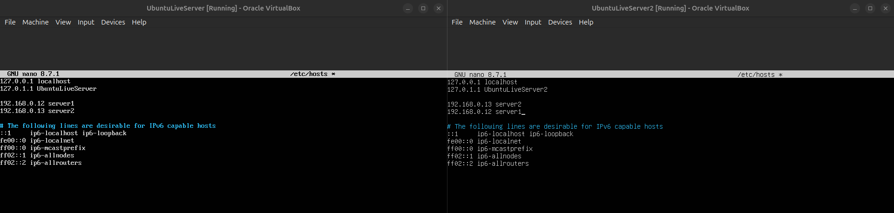
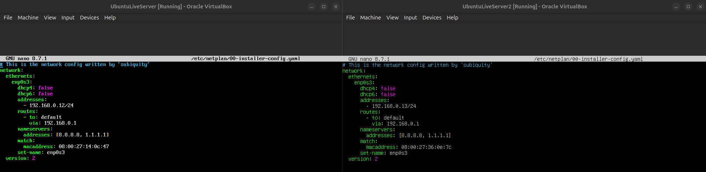
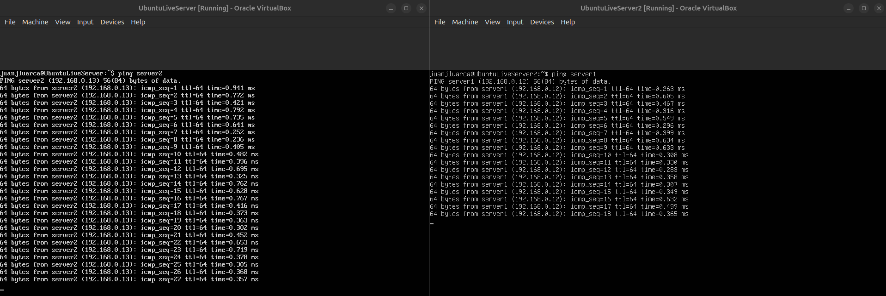

# Homework 02

## Cambiar nombre al Host Virtual 1 y 2
Se utilizó el comando `hostnamectl set-hostname` en cada servidor para asignarle su nombre (server1 y server2).

---

## Configurar cada Host para que se reconozca por su nombre
Se editó el archivo `/etc/hosts` en ambos servidores para que cada uno reconozca al otro por su nombre además de su IP.

- server1:
**192.168.0.12**
- server2:
**192.168.0.13**

---

## Configurar la IP de cada Host dentro de la subred de mi casa
Se editó el archivo `/etc/netplan/00-installer-config.yaml` en cada servidor para cambiar de DHCP a IP estática dentro del rango de mi red (192.168.0.0), y se aplicaron los cambios con `netplan apply`.

## Ping entre server1 y server2 (utilizando los nombres configurados)
Desde server1 se ejecutó `ping server2` y desde server2 se ejecutó `ping server1`, confirmando la comunicación entre ambas máquinas virtuales dentro de la misma subred.

