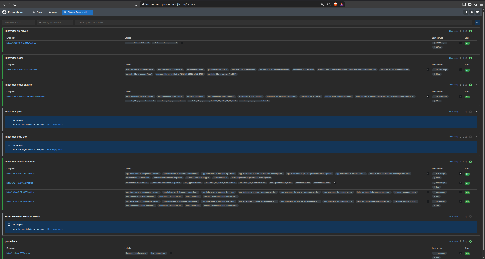
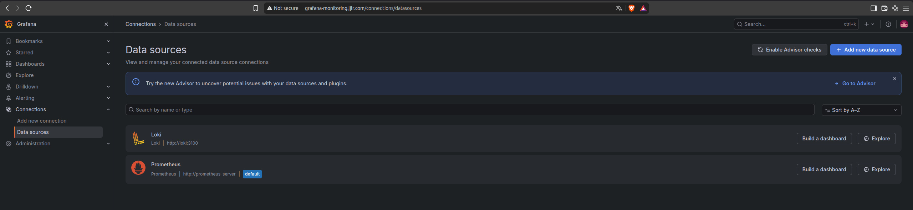
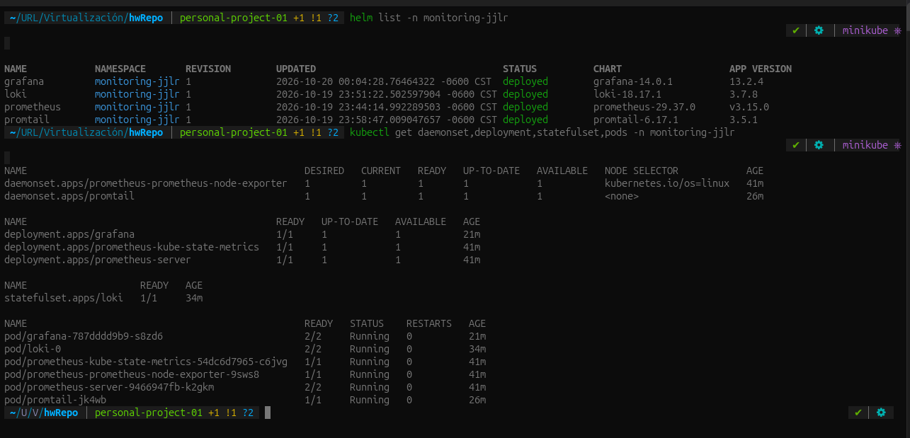
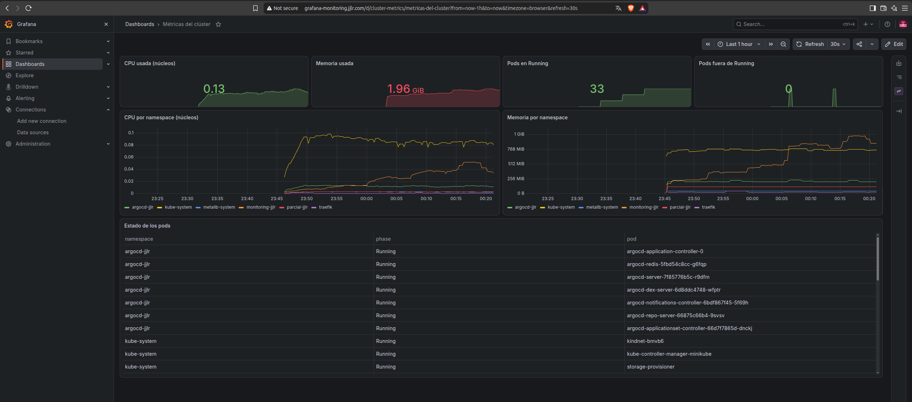
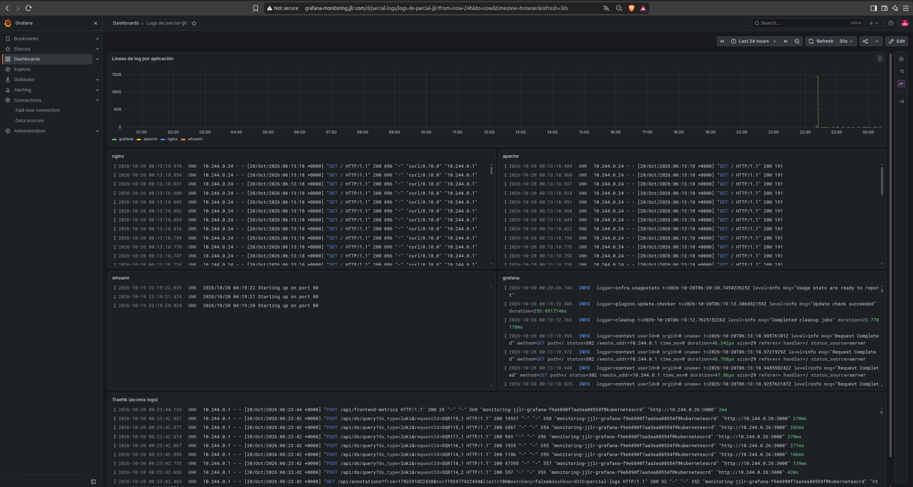
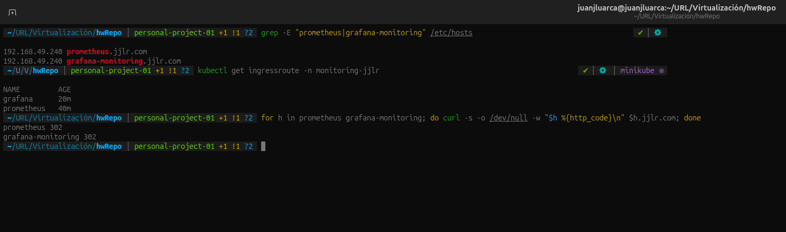

# Personal Project 01

Stack de monitoreo y centralización de logs en el clúster de Minikube. Prometheus recolecta métricas, Promtail envía los logs de los contenedores a Loki y Grafana muestra ambos en dashboards. Grafana y Prometheus se exponen por Traefik con la IP de MetalLB. Todos los componentes están en el namespace `monitoring-jjlr` y se instalan con Helm.

### 1. Preparación

El clúster se recreó con más memoria para soportar el stack, y se volvió a aplicar la configuración de `assessment-02`.

```bash
minikube start --memory=8192 --cpus=4 --container-runtime=containerd
```

Se instaló Helm, se registraron los repositorios de los charts y se creó el namespace.

```bash
sudo snap install helm --classic
helm repo add prometheus-community https://prometheus-community.github.io/helm-charts
helm repo add grafana-community https://grafana-community.github.io/helm-charts
helm repo add grafana https://grafana.github.io/helm-charts
kubectl apply -f monitoring/namespace.yaml
```

### 2. Prometheus

```bash
helm install prometheus prometheus-community/prometheus --version 29.37.0 -n monitoring-jjlr -f monitoring/prometheus-values.yaml
```

El chart incluye kube-state-metrics (estado de los objetos de Kubernetes) y node-exporter (métricas del nodo). `monitoring/prometheus-values.yaml` desactiva Alertmanager, Pushgateway y los jobs que dependen de ellos, y excluye el namespace `metallb-system` del job `kubernetes-pods`, porque MetalLB sirve sus métricas por HTTPS con autenticación y aparecería como DOWN.



### 3. Loki

```bash
helm install loki grafana-community/loki --version 18.17.1 -n monitoring-jjlr -f monitoring/loki-values.yaml
```

`monitoring/loki-values.yaml` despliega Loki en modo monolítico (un solo pod) con almacenamiento en disco, sin autenticación de tenants y sin gateway, cachés ni componentes de prueba.

### 4. Promtail

```bash
helm install promtail grafana/promtail --version 6.17.1 -n monitoring-jjlr -f monitoring/promtail-values.yaml
```

Promtail corre como DaemonSet. `monitoring/promtail-values.yaml` define el destino de los logs (`http://loki:3100/loki/api/v1/push`); el resto es la configuración por defecto del chart, que descubre los pods del clúster, lee sus archivos en `/var/log/pods` y agrega las etiquetas `namespace`, `pod`, `container` y `app`. Promtail llegó a fin de vida en marzo de 2026 y se usa porque lo requiere la actividad.

Para que Traefik registre cada petición, se agregó `--accesslog=true` a `traefik/03-deployment.yaml`.

### 5. Grafana

```bash
helm install grafana grafana-community/grafana --version 14.0.1 -n monitoring-jjlr -f monitoring/grafana-values.yaml
```

`monitoring/grafana-values.yaml` provisiona los data sources Prometheus y Loki como código y activa el sidecar que carga los dashboards desde ConfigMaps con la etiqueta `grafana_dashboard: "1"`.




### 6. Dashboards

Los dashboards son archivos JSON en `monitoring/dashboards/`, convertidos en ConfigMaps con Kustomize.

```bash
kubectl apply -k monitoring/dashboards/
```

- `cluster-metrics.json`: CPU y memoria totales y por namespace, pods por estado y tabla con el estado de cada pod.
- `parcial-logs.json`: líneas de log por aplicación, un panel de logs para cada aplicación de `parcial-jjlr` y otro para los access logs de Traefik.




### 7. Exposición por medio de Traefik y DNS

`monitoring/prometheus-ingressroute.yaml` y `monitoring/grafana-ingressroute.yaml` exponen Prometheus en `prometheus.jjlr.com` y Grafana en `grafana-monitoring.jjlr.com`. Se agregaron ambos dominios a `/etc/hosts` apuntando a la IP del LoadBalancer de Traefik.

```bash
kubectl apply -f monitoring/prometheus-ingressroute.yaml -f monitoring/grafana-ingressroute.yaml
```


