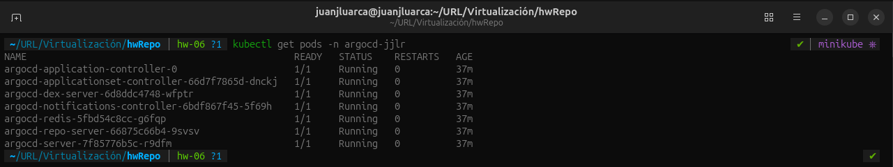
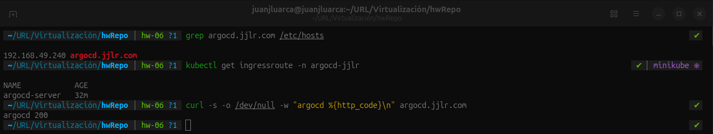
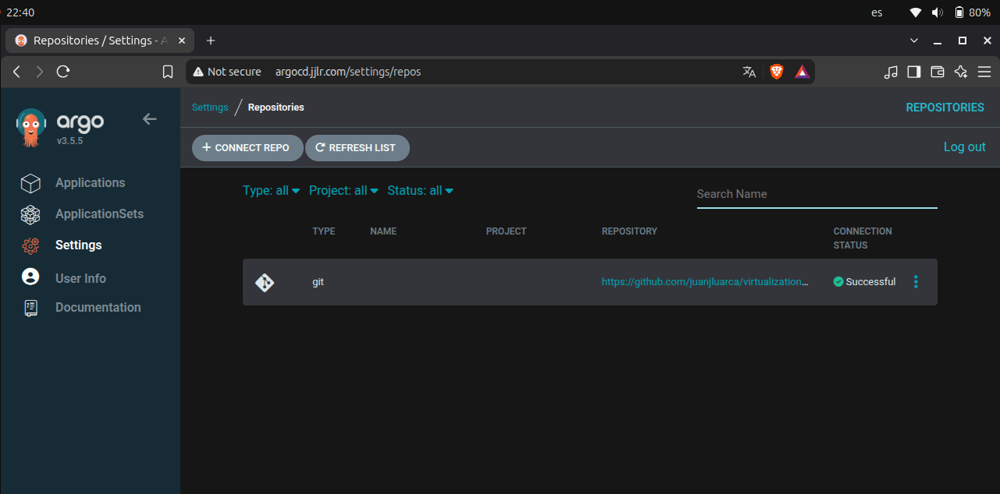
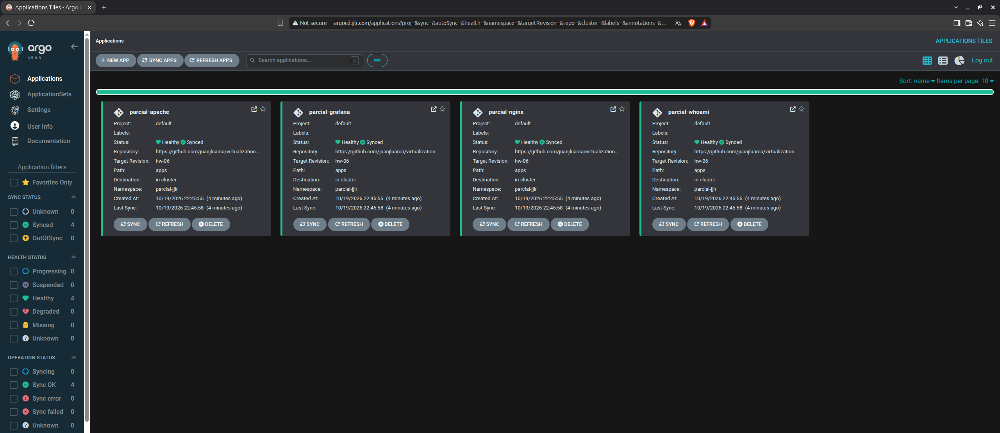
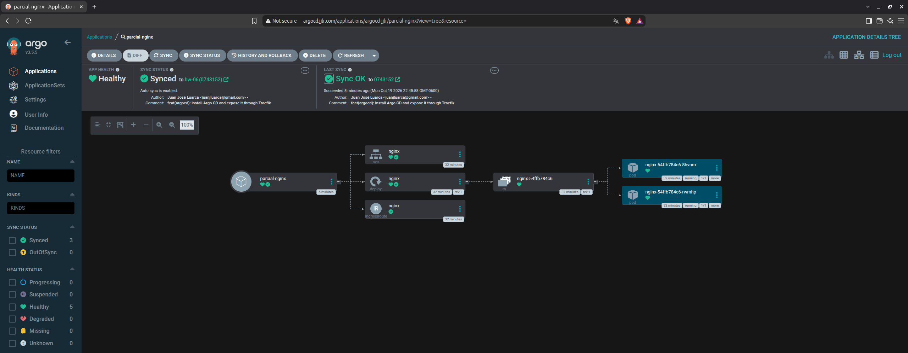
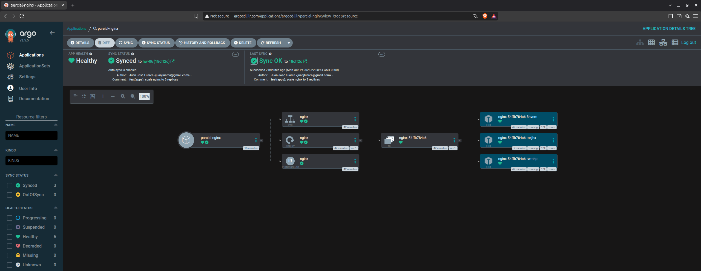

# Homework 06

Instalación de Argo CD en el clúster de Minikube para desplegar las aplicaciones del namespace `parcial-jjlr` con el enfoque GitOps, a partir de la rama `hw-06` de este repositorio.

### 1. Instalación de Argo CD

Argo CD v3.5.5 se instala en el namespace `argocd-jjlr` con Kustomize. `argocd/kustomization.yaml` toma el manifiesto oficial, ajusta el namespace de los ClusterRoleBinding (que en el original apuntan a `argocd`) y activa `server.insecure: "true"` para que Argo CD sirva HTTP detrás de Traefik.

```bash
kubectl apply -k argocd/ --server-side --force-conflicts
```

Se usa `--server-side` porque una de las CRD de Argo CD supera el límite de tamaño del apply normal.



### 2. Exposición por medio de Traefik

`argocd/ingressroute.yaml` enruta el dominio `argocd.jjlr.com` al Service `argocd-server`. Se agregó el registro a `/etc/hosts` apuntando a la IP del LoadBalancer de Traefik. La contraseña inicial del usuario `admin` se obtiene con:

```bash
kubectl -n argocd-jjlr get secret argocd-initial-admin-secret -o jsonpath="{.data.password}" | base64 -d
```



### 3. Conexión al repositorio

`argocd/repository.yaml` registra el repositorio en Argo CD mediante un Secret con la etiqueta `argocd.argoproj.io/secret-type: repository`. Al ser un repositorio público, no requiere credenciales.



### 4. Applications

La carpeta `apps/` se copió desde la rama `assessment-02`. `argocd/applications.yaml` define cuatro Applications, una por aplicación. Cada una lee su archivo de `apps/` en la rama `hw-06` y lo despliega en `parcial-jjlr` con sincronización automática y `CreateNamespace=true`.

```bash
git checkout assessment-02 -- apps
kubectl apply -k argocd/ --server-side --force-conflicts
```




### 5. Sincronización de un cambio

Se subió nginx de 2 a 3 réplicas en el repositorio. Argo CD detectó el commit y lo sincronizó automáticamente en el clúster.

```bash
sed -i 's/replicas: 2/replicas: 3/' apps/nginx.yaml
git add apps/nginx.yaml
git commit -m "feat(apps): scale nginx to 3 replicas"
git push
```



