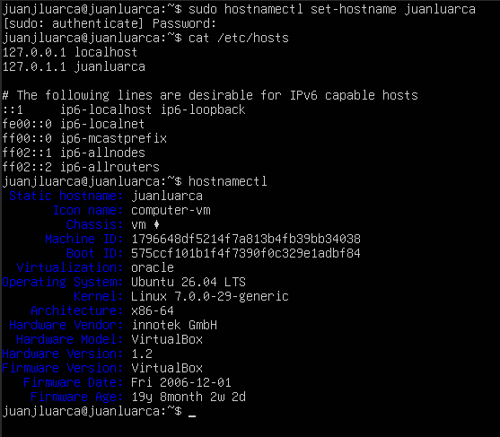
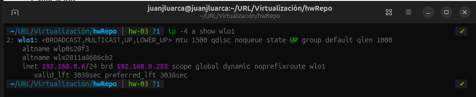
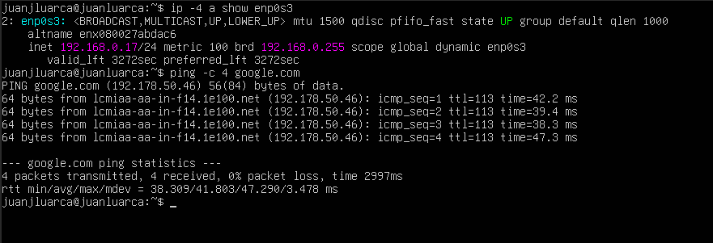
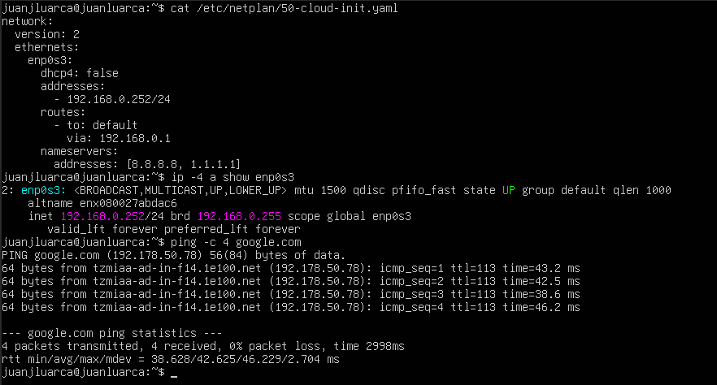
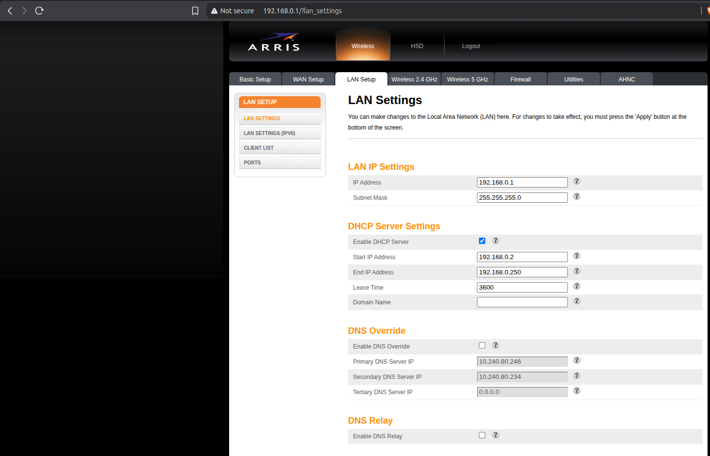
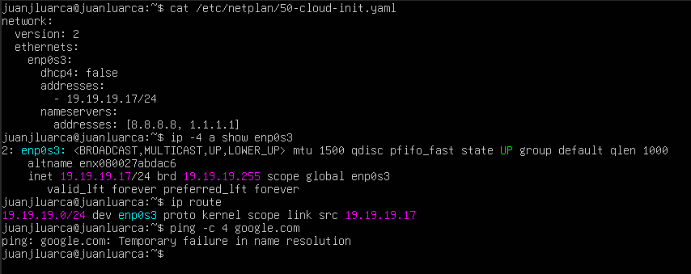

# Homework 03

## Hostname
 
Hostname de la VM configurado como `juanluarca`.
 

 
## Subred del hipervisor
 
Subred `192.168.0.0/24`, máscara `255.255.255.0`, gateway `192.168.0.1`.
 

 
## Escenario 1 — Bridge con IP por DHCP
 
IP obtenida automáticamente: `192.168.0.17/24`. Ping exitoso, 0% de pérdida.
 

 
## Escenario 2 — Bridge con IP manual dentro de la subred
 
IP asignada manualmente: `192.168.0.252/24`, dentro de la subred del hipervisor y fuera del rango DHCP del router. Ping exitoso, 0% de pérdida.
 

*(Para este Escenario se modificó el rango DHCP directamente desde el router para que abarcara desde la .2 hasta la .250)*

 
## Escenario 3 — Bridge con IP manual fuera de la subred
 
IP asignada manualmente: `19.19.19.17/24`, fuera de la subred del hipervisor. El ping falla porque no existe ruta por defecto: al estar en otra red, la VM no puede alcanzar el gateway `192.168.0.1` ni los servidores DNS.
 

