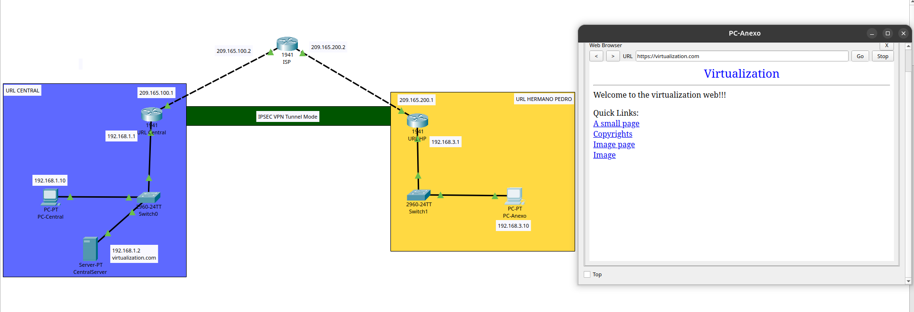
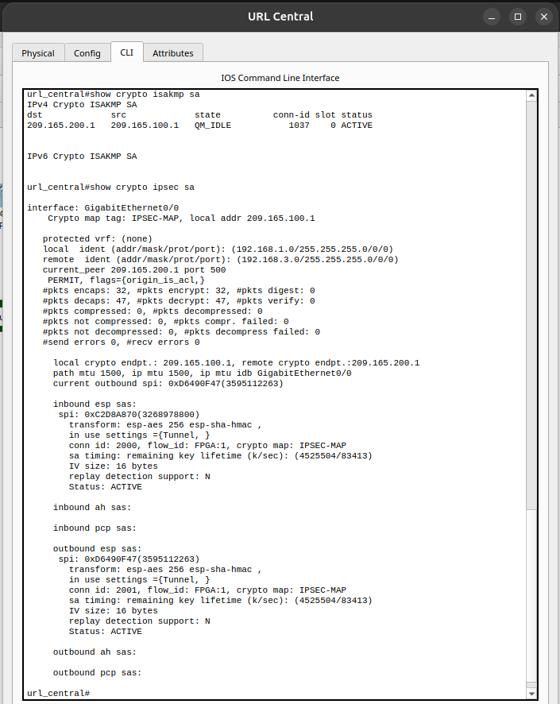
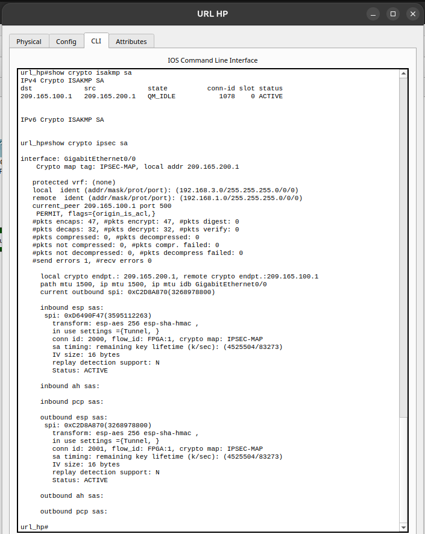

# Homework 04

Se configuró un túnel IPSec en modo túnel entre dos routers (`url_central` y `url_hp`), conectando dos redes con subnets distintas a través de un router intermedio que simula Internet. Un servidor web en la red de `url_central` responde solicitudes HTTPS realizadas desde una PC de la red opuesta (`url_hp`).

## Topología

- **Red 1:** 192.168.1.0/24 — Router `url_central` — Servidor web `CentralServer` (192.168.1.2 / virtualization.com)
- **Red 2:** 192.168.3.0/24 — Router `url_hp` — PC cliente `PC-Anexo` (192.168.3.10)
- **Router intermedio (ISP):** conecta 209.165.100.0/24 y 209.165.200.0/24

## Configuración IPSec

- Fase 1 (ISAKMP): AES 256, SHA (default), pre-shared key, DH group 5
- Fase 2 (IPSec): transform-set esp-aes 256 / esp-sha-hmac, **modo túnel**
- Crypto map aplicado en la interfaz WAN de ambos routers principales

## Evidencia de la solicitud HTTPS

Solicitud realizada desde `PC-Anexo` (192.168.3.10, red de `url_hp`) hacia `https://virtualization.com`, servidor ubicado en la red de `url_central`.

## Evidencia del túnel IPSec activo

Salida de `show crypto isakmp sa` y `show crypto ipsec sa` en ambos routers, mostrando el túnel activo y el tráfico cifrado (paquetes encapsulados/desencapsulados).

**Router url_central:**

**Router url_hp:**

## Archivos

- Archivo de configuración de Packet Tracer: [Archivo Packet Tracer](pt-file/ipsec-vpn-tunnel.pkt)